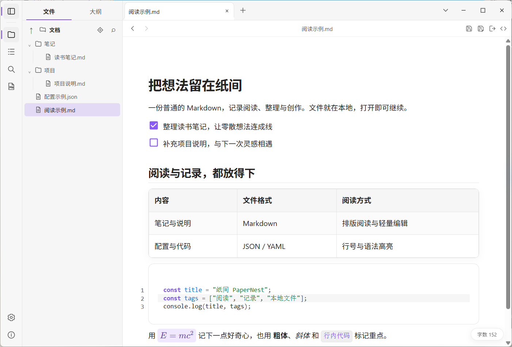
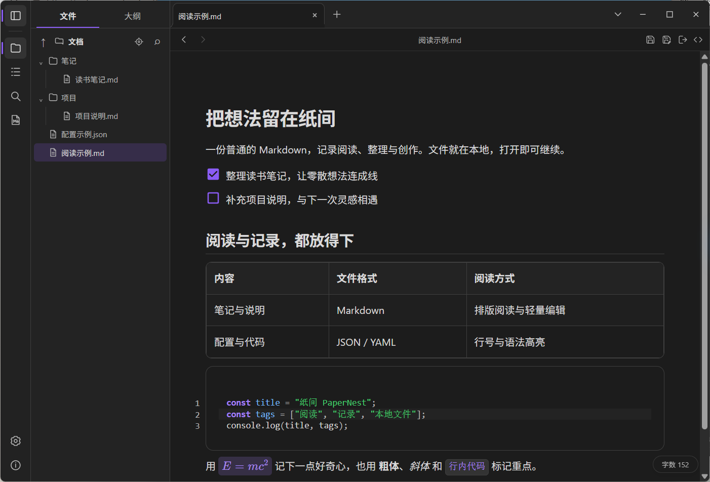
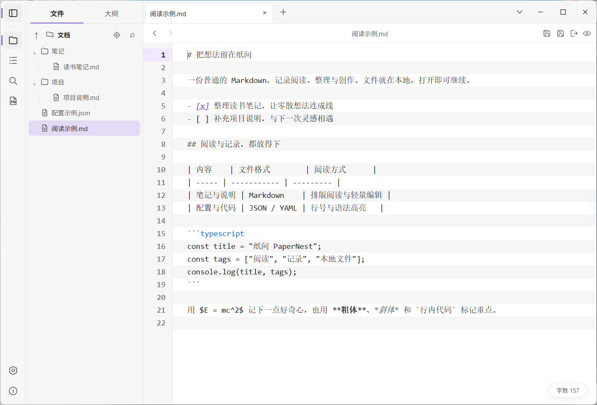
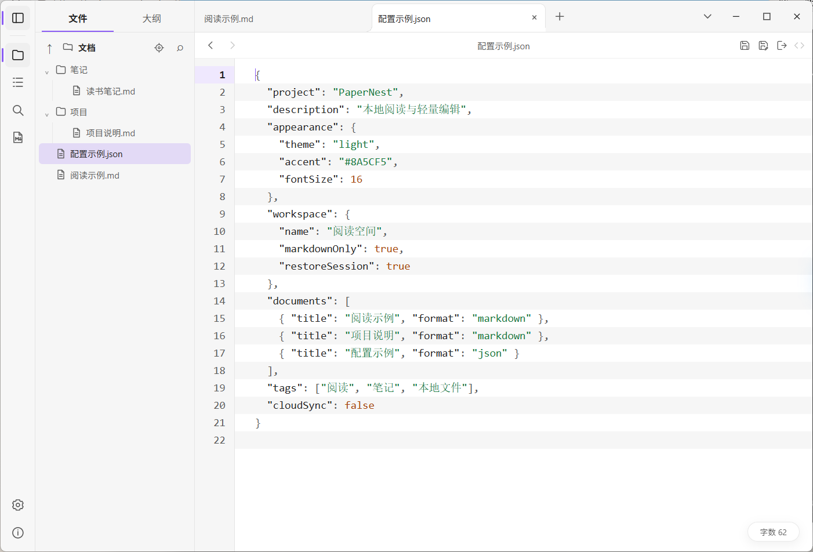
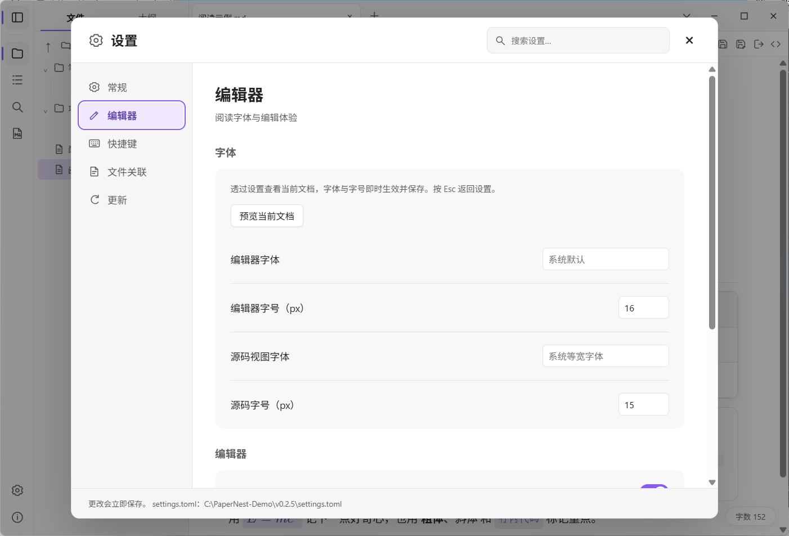
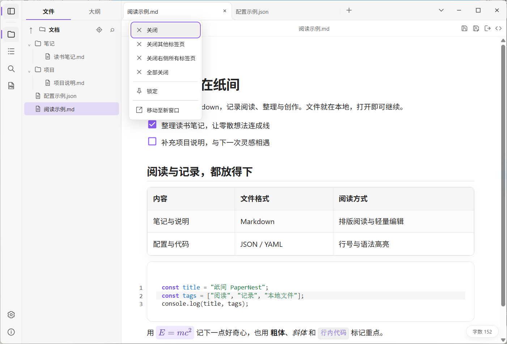

<div align="center">


# 纸间 PaperNest

面向本地文件的轻量桌面阅读与编辑工具。<br>
打开 Markdown 即可阅读和修改，也能快速查看代码、配置、日志与图片。

[](https://github.com/baihejiangnan/PaperNest/releases/latest)
[](LICENSE.md)
[](https://github.com/baihejiangnan/PaperNest/releases/latest)

[Windows / Linux 下载](https://github.com/baihejiangnan/PaperNest/releases/latest) · [macOS 测试版](https://github.com/baihejiangnan/PaperNest/releases/tag/macos-v0.2.5-preview.1) · [项目介绍页](https://baihejiangnan.github.io/PaperNest/) · [English](README.en.md)

</div>



*PaperNest v0.2.5 的 Windows 实际运行截图，使用演示文档；下方可查看深色主题、源码、JSON、设置和标签页菜单。*

---

## 目录

- [功能亮点](#功能亮点)
- [界面预览](#界面预览)
- [下载与安装](#下载与安装)
- [快速上手](#快速上手)
- [快捷键](#快捷键)
- [文件与数据](#文件与数据)
- [从源码构建](#从源码构建)
- [项目结构与文档](#项目结构与文档)
- [致谢与许可](#致谢与许可)

## 功能亮点

| | |
| --- | --- |
| **所见即所得的 Markdown** | Milkdown/Crepe 渲染标题、列表、任务、表格、链接、脚注和数学公式；一键切换到带行号与语法高亮的源码视图。 |
| **不只是 Markdown** | JSON、YAML、TOML、代码、日志和纯文本进入 Code 模式，支持查找、替换与轻量修改；图片在独立标签页预览。 |
| **文件树与多标签页** | 按需读取目录，默认聚焦 Markdown 文档；标签页可堆叠、收藏和恢复，配合大纲、目录内搜索、前进/后退和会话恢复。 |
| **安全的文件操作** | 新建、重命名、复制、删除都在应用内完成；删除前显示引用情况，文件移入系统回收站，可随时恢复。 |
| **导出 HTML 与 PDF** | 导出独立 HTML，或通过系统打印输出 PDF；导出时移除文档中的脚本等可执行内容。 |
| **按习惯调整** | 浅色、深色或跟随系统；自定义强调色、字体和字号，快捷键可重新绑定，设置支持跨分类搜索。 |

## 界面预览

浅色主界面见上图。以下截图均来自 v0.2.5，使用同一组演示文件。

<details>
<summary><b>查看更多界面截图</b></summary>

### 深色主题

同一份 Markdown、同一套文件树，切换到深色主题。



### Markdown 源码

按 `Ctrl+/` 切换源码视图，查看行号、Markdown 标记与语法高亮。



### Code 模式

JSON 配置文件直接进入 Code 模式，无须转换为 Markdown。



### 编辑器设置

在分类设置中调整阅读字体、字号和编辑习惯，也可以预览当前文档。



### 标签页菜单

右键标签页可批量关闭、锁定，或移动至独立窗口。锁定可防止文件树预览替换该标签。



</details>

## 下载与安装

当前正式版为 **v0.2.5**。Windows 与 Linux 包在[正式版 Releases](https://github.com/baihejiangnan/PaperNest/releases/latest)，macOS 单独提供[未公证测试版](https://github.com/baihejiangnan/PaperNest/releases/tag/macos-v0.2.5-preview.1)。

| 平台 | 下载包 | 选择方式 |
| --- | --- | --- |
| Windows x64 | [便携 EXE](https://github.com/baihejiangnan/PaperNest/releases/download/v0.2.5/PaperNest-0.2.5.exe) / [安装 MSI](https://github.com/baihejiangnan/PaperNest/releases/download/v0.2.5/PaperNest_0.2.5_x64.msi) | EXE 直接运行；MSI 适合安装到系统并配置文件关联。 |
| Linux x86_64 | [AppImage](https://github.com/baihejiangnan/PaperNest/releases/download/v0.2.5/PaperNest-0.2.5-linux-x86_64.AppImage) / [deb](https://github.com/baihejiangnan/PaperNest/releases/download/v0.2.5/PaperNest-0.2.5-linux-x86_64.deb) / [rpm](https://github.com/baihejiangnan/PaperNest/releases/download/v0.2.5/PaperNest-0.2.5-linux-x86_64.rpm) | 按发行版选择应用包或软件包；兼容性说明见 Release。 |
| macOS Intel / Apple Silicon | [Universal DMG 测试版](https://github.com/baihejiangnan/PaperNest/releases/tag/macos-v0.2.5-preview.1) | 同一包包含双架构；使用临时签名，**未经过 Apple 公证**。 |

- Windows 需要 **WebView2 Runtime**。当前没有 Windows Authenticode 证书签名，首次运行时系统可能提示来源未知。
- 各平台均附带 SHA-256 清单；Windows EXE 与 MSI 另有应用更新签名。更新签名与系统认可的发布者证书是不同的验证方式。
- Windows 可在“设置 → 更新”检查、下载和安装更新，无需 GitHub 登录或 Token。自动检查默认关闭，下载和安装均需确认；安装前保存阅读会话，更新后恢复。
- Linux 与 macOS 暂不支持应用内自动安装更新，请从 Releases 手动下载。两者已通过原生构建与测试，Linux 另通过窗口启动检查，macOS 另核验了最终 DMG 的双架构和签名完整性；完整实机功能验收仍待完成。详细范围见[开发记录](docs/development.md)及 [TODO](TODO.md)。

> PaperNest 基于 [MDmeow](https://github.com/zakee039/MDmeow) 持续开发；请下载本仓库的发行包以使用这里的功能。

## 快速上手

1. **打开文件**：`Ctrl+O`、拖放文件到窗口，或在左侧文件树中点击。
2. **切换视图**：`Ctrl+/` 在 Markdown 渲染视图和源码视图之间切换。
3. **浏览目录**：文件树顶部的 ↑ 返回上一级，◎ 回到当前文档所在目录；右键文件夹可“设为根目录”。
4. **保留标签页**：普通点击会复用预览标签页；右键选择“在新标签页中打开”保留独立标签页，“在新窗口中打开”打开单文档窗口。
5. **调整外观**：`Ctrl+,` 打开设置，修改主题、强调色、字体和快捷键。

<details>
<summary><b>文件树</b></summary>

- 默认只显示 Markdown 文档（`.md`、`.markdown`、`.mdx`，不区分大小写）及其祖先文件夹。搜索下方的 MD 图标可关闭筛选，常规设置提供同一开关。
- 目录按需读取；显示时定期同步根目录和已展开的子目录，返回窗口时立即刷新。以点号开头的项目和符号链接会被隐藏。
- 往上一级后，路径栏以淡色保留原来更深的文件夹，点击即可回到那一层。路径段支持 Tab／Shift+Tab 遍历、Enter／空格进入。
- 拖动侧栏分隔线调整宽度，双击恢复默认；聚焦后可用方向键（Shift 加速）和 Home／End。
- Windows 下右键“在资源管理器中打开”会打开所选文件夹，或打开文件所在目录并选中该文件。

</details>

<details>
<summary><b>标签页与窗口</b></summary>

- 标题栏加号打开新标签页，可创建或打开文件；标签过多时自动缩窄。右侧箭头可切换、堆叠、收藏及关闭标签页。
- 右键标签可关闭当前、其他、右侧或全部标签，锁定／取消锁定，以及移动至新窗口；右键不会切换当前文档。锁定防止文件树预览替换该页，当前运行期间有效，仍可手动关闭。移动前先保存，取消保存或创建窗口失败时保留源标签。
- 收藏会保存有文件路径的标签页列表，之后可从箭头菜单恢复；未保存的新文件不会进入收藏。
- “常规 → 启动时恢复阅读会话”默认开启：直接启动时恢复文件、活动标签、阅读位置、源码视图和项目根目录。关闭后显示新建标签页；指定文件启动时打开指定文件。Windows 安装版和便携版在同一用户下共享最近会话与此开关。
- 指定文件读取失败时保留旧会话；成功打开其他文件或另存为后继续记录。Windows 安装后通过桌面 Explorer 以普通权限启动，便于后续双击文件转交已有窗口。
- 右键打开独立标签页时立即显示标签，读取较慢时显示“正在打开文件…”；加载期间可以切换或关闭标签页。
- 关闭标签页、替换预览页、退出或安装更新时，如有未保存的修改，可选择“保存”“不保存”或“取消”；多个文档时为“全部保存”。保存失败或取消另存为时不会关闭任何内容。
- “在新窗口中打开”在同一应用进程中创建只显示单个文档的窗口，不附带文件树、大纲或标签栏。

</details>

<details>
<summary><b>编辑与右键菜单</b></summary>

- 正文右键菜单可添加或编辑链接、查找文字、设置文本格式、转换标题与列表，以及插入表格、图片、分隔线、代码块和数学块；Shift+F10 可从键盘打开。
- “添加链接／编辑链接”在选区附近打开轻量浮层，可输入网址或本地路径，也可搜索当前文档的同级文件并插入相对链接。
- 点击图片可放大预览，并调整对齐和缩放。相对图片与本地链接以当前文档所在目录解析。
- 二进制文件不会按文本打开；不支持的格式或编码会在窗口顶部显示一条 4 秒后消失的提示，不打断阅读。
- “编辑器 → 自动保存已编辑的文件”默认关闭。开启后，已有文件路径的文档在停止输入约 1.5 秒后、切换标签页和窗口失去焦点时保存，关闭时也直接保存；未命名文档仍会询问。只打开文件不会写入。
- 保存 Markdown 时列表符号默认写为 `-`，可在“编辑器”中改为 `*` 或 `+`（已有 `settings.toml` 中的选择会保留）；单词内部的下划线（如 `CODE_MODE_PLAN`）不再加反斜杠。

</details>

<details>
<summary><b>设置</b></summary>

- 设置使用左侧分类导航；顶部“搜索设置”可跨分类查找名称、配置键名和文件扩展名。
- “编辑器 → 字体”中的“预览当前文档”会淡化设置遮罩，直接查看背后文档的排版；按 Esc 返回。
- 删除确认显示文件数量和引用来源，勾选“不再询问”后可在“常规 → 删除文件前询问”恢复。
- Windows 的“常规 → Windows 资源管理器”提供“在右键‘新建’中显示 MD 文件”开关，默认关闭，即使应用未运行也能在系统“新建”菜单创建 `.md` 文件。不会覆盖现有默认打开程序；便携版删除前请先关闭此开关。

</details>

## 快捷键

| 操作 | 默认快捷键 |
| --- | --- |
| 新建标签页 | `Ctrl+N` |
| 打开文件 | `Ctrl+O` |
| 保存 / 另存为 | `Ctrl+S` / `Ctrl+Shift+S` |
| 关闭标签页 | `Ctrl+W` |
| 导出 HTML / PDF | `Ctrl+E` |
| 渲染 / 源码视图 | `Ctrl+/` |
| 查找 / 替换 | `Ctrl+F` / `Ctrl+H` |
| 设置 | `Ctrl+,` |

macOS 使用 `Cmd` 代替 `Ctrl`。应用级快捷键可在设置中重新绑定。

## 文件与数据

**普通文件，原样读写。** 纸间直接读写本地文件，不需要导入专用库或项目。Markdown 保持普通文本，标准图片链接和常见 HTML `` 都能显示：

```md


```

**设置保存在本地。** 偏好和本地会话保存在 `settings.toml`，修改后即时保存。Windows 便携版将 `settings.toml` 放在 EXE 旁，`data/` 保存 WebView2 数据与更新缓存；目录不可写时回退到用户配置目录。安装版使用系统用户配置目录。上述共享恢复另在用户配置目录 `PaperNest/reading-session.toml` 保存会话和恢复开关；其他外观偏好仍各自保留。滚动位置防抖保存，正常退出立即保存；直接结束进程只能恢复最近已写入的位置。手动编辑 settings.toml 导致无法解析时，启动会提示错误，原文件另存为 `settings.invalid-<时间>.toml`，并以默认设置运行。

**按习惯调整。** 设置按分类分组，修改即时保存。正文、源码和代码块的右键菜单默认隐藏快捷键文字；可在“常规 → 行为 → 内容区右键菜单显示快捷键”开启。

**删除可以撤回。** 文件和文件夹删除会移入系统回收站；移入失败时只提示错误，不会改为永久删除。

**不上传、不同步。** 应用不会把文档同步到云端，换电脑时请自行备份文件与设置。

## 从源码构建

需要 Node.js 20+、pnpm 和 Rust stable（最低 1.85）；Windows 还需要 Visual C++ Build Tools、Windows SDK 和 WebView2。

```bash
pnpm install --frozen-lockfile
pnpm tauri dev        # 启动开发版
pnpm build            # 检查前端类型与构建
pnpm tauri build      # 本机打包
```

`pnpm release:windows` 生成 Windows x64 便携 EXE、MSI、更新签名、`latest.json` 和 `SHA256SUMS.txt`。调试方法和回归清单见 [开发说明](docs/development.md)，正式发行流程见 [推送与发行规则](docs/release-rules.md)。

在对应系统运行 `pnpm release:macos`（Universal DMG）或 `pnpm release:linux`（本机架构的 AppImage、deb、rpm），产物写入 `release-unix/`，附带构建信息与 SHA-256 清单。也可使用手动触发的[跨平台构建工作流](.github/workflows/unix-candidates.yml)。依赖、签名和验收步骤见[跨平台开发说明](docs/development.md#macoslinux-候选包准备)。

## 项目结构与文档

| 路径 | 内容 |
| --- | --- |
| `src/` | 前端界面、Markdown 与 Code 模式、标签页和文件树 |
| `src-tauri/` | Rust 文件操作、窗口、设置、平台集成和打包 |
| `docs/index.html` | [项目介绍页](https://baihejiangnan.github.io/PaperNest/)（GitHub Pages） |
| [ARCHITECTURE.md](ARCHITECTURE.md) | 前后端边界、状态归属与数据流 |
| [docs/design.md](docs/design.md) | 全局 UI 规范与配色 |
| [docs/development.md](docs/development.md) | 本地命令、调试与回归记录 |
| [docs/release-rules.md](docs/release-rules.md) | 推送与发行规则 |
| [TODO.md](TODO.md) | 待验证和待完成事项 |

技术栈：Tauri v2 · Rust · TypeScript · Milkdown/Crepe · CodeMirror · KaTeX

## 致谢与许可

感谢 [zakee039 的 MDmeow](https://github.com/zakee039/MDmeow) 提供了本项目的直接基础，也感谢更早的 [Ali Naderi / Mowl](https://github.com/naderi/mowl)。纸间在这些工作之上扩展了本地文件阅读、文件树、图片预览与界面体验。

本项目采用 [MIT License](LICENSE.md)，原有版权与许可文本保留在其中。
